class: center middle

<!--
Deck notes
- No full stops anywhere
- High level points only: 1 to 2 words
- Tell the story with SVG visuals and animations, not text
-->

.font-size-4.weight-700[
Anatomy of a .tc-underline[Software Factory]
]

---

class: grid-2

.cell[

# .tc-underline[About Me]

]

.cell[

## Tushar Mathur

- .icon[] Founder .font-grey[ForgeCode]
- .icon[] Ex VP Engineering .font-grey[Dream11]
- .icon[heart] Loves .font-grey[DevTools]

]

---

class: middle

# State of Software Engineering   in .tc-underline[2026]

---

class: grid-2 center

# .icon[sparkles] 100% Auto Generated

---

class: middle

### Individual Productivity

# .icon[arrow-right] Massive Increase

---

class: middle center fig

.bottleneck-fig[]

--

### Individual Productivity .icon[equal-not] Organizational Velocity

---

class: middle

### Scaling Engineering

# .icon[arrow-up] Increasing Headcount

---

class: middle

### .tc-underline[Bottlenecks] have moved .icon[arrow-right]

.bottleneck-fig[]

---

class: middle

## Scaling Engineering .icon[message-circle-question-mark]

--

.fill[]

---

class: middle

## .tc-underline[State] of the Art Software Factory

.confetti[]

---

class: middle wide

## .logo-heading[] .icon[arrow-right]

---

class: middle

## .icon[bot] Works Autonomously .font-grey[1/6]

.fill[]

---

class: middle

## .icon[refresh-cw] Continuously Improves .font-grey[2/6]

.fill[]

---

class: middle

## .icon[chart-line] Measures Outcomes .font-grey[3/6]

.fill[]

---

class: middle

## .icon[expand] Highly Scalable .font-grey[4/6]

.fill[]

---

class: middle

## .icon[sliders-horizontal] Business Controlled .font-grey[5/6]

.fill[]

---

class: middle

## .icon[piggy-bank] Cost Effective .font-grey[6/6]

.fill[]

---

class: grid-2 top

.cell.span-all[

#### Six Tenets of the Software Factory .icon[arrow-right]

]

.cell[

### .icon[bot] Works Autonomously

### .icon[refresh-cw] Continuously Improves

### .icon[chart-line] Measures Outcomes

]

.cell[

### .icon[expand] Highly Scalable

### .icon[sliders-horizontal] Business Controlled

### .icon[piggy-bank] Cost Effective

]

---

class: middle

# The New Engineering Org .icon[arrow-right]

## with Software .tc-underline[Factories]

---

class: middle

### .icon[arrow-right] Scale SDLC

### .icon[arrow-right] Lean Organization

### .icon[arrow-right] Build not Buy

---

class: middle center

.compare[

#### Individual Productivity

#### Organizational .tc-underline[Velocity]

]

---

class: grid-2 closing

.cell[

## Build Your Software .tc-underline[Factory]

### .icon[calendar] Book a Demo

]

.cell.qr[

.font-grey[forgecode.dev]

]
