class: center middle

<!--
Deck notes
- No full stops anywhere
- High level points only: 1 to 2 words
- Tell the story with SVG visuals and animations, not text
-->

.font-size-4.weight-700[
Anatomy of a .tc-underline[Software Factory]
]

---

class: grid-2

.cell[

# .tc-underline[About Me]

]

.cell[

## Tushar Mathur

- .icon[] CEO .font-grey[ForgeCode]
- .icon[] VP Engineering .font-grey[Dream11]
- .icon[heart] Passionate about .font-grey[DevTools]

]

---

class: middle

### .font-grey[Part 1]

# .tc-underline[State] of Software in 2026 .icon[arrow-right]

---

class: grid-2 center

# .icon[arrow-right] .tc-underline[100%] Auto Generated

---

class: middle center

# Individual Productivity   .icon[equal-not]   Organizational Velocity

---

class: bottom

## .icon[arrow-up] Individual Productivity


---

class: bottom

## .icon[arrow-right] Organizational Velocity


---

class: middle

## .tc-underline[Bottleneck] .font-grey[Before]


---

class: middle

## .tc-underline[Bottlenecks] Have Moved .icon[arrow-down]


---

class: middle

### .font-grey[Part 2]

# .tc-underline[Scaling] SDLC .icon[arrow-right]

---

class: middle

## .tc-underline[More] People .font-grey[1/2]

.flex-row.spread[

### .icon[triangle-alert] Bottlenecks

### .icon[triangle-alert] Coordination

### .icon[triangle-alert] Cost

]

---

class: middle

## .tc-underline[More] Tokens .font-grey[2/2]

---

class: middle

## .tc-underline[More] Tokens .font-grey[2/2]

.flex-row.spread[

### .icon[triangle-alert] Signal

### .icon[triangle-alert] Feedback

### .icon[triangle-alert] Control

]

---

class: middle

### .font-grey[Part 3]

# .tc-underline[Who] Runs the Line .icon[message-circle-question-mark]

---

class: middle celebrate

## .tc-underline[State] of the Art Software Factory

---

class: diagram

## The .tc-underline[Idea]

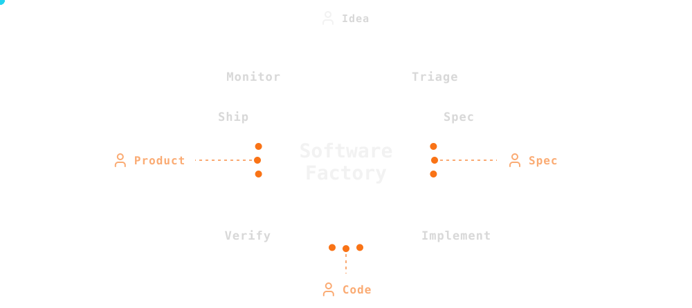

---

class: diagram

## How It .tc-underline[Works]

---

class: middle

### .font-grey[Part 4]

# .tc-underline[ForgeCode] Tenets .icon[arrow-right]

---

class: diagram

## .icon[bot] Works Autonomously .font-grey[1/6]


.text-center[

### .font-grey[Fixes] Bottlenecks

]

---

class: diagram

## .icon[expand] Highly Scalable .font-grey[2/6]


.text-center[

### .font-grey[Fixes] Coordination

]

---

class: diagram

## .icon[piggy-bank] Cost Effective .font-grey[3/6]


.text-center[

### .font-grey[Fixes] Cost

]

---

class: diagram

## .icon[chart-line] Measurable .font-grey[4/6]


.text-center[

### .font-grey[Fixes] Signal

]

---

class: diagram

## .icon[refresh-cw] Improves Automatically .font-grey[5/6]


.text-center[

### .font-grey[Fixes] Feedback

]

---

class: diagram

## .icon[sliders-horizontal] Business Controlled .font-grey[6/6]

.text-center[

### .font-grey[Fixes] Control

]

---

class: grid-2 top

.cell.span-all[

## Tenets .tc-underline[Recap]

]

.cell[

### .icon[bot] Works Autonomously

### .icon[expand] Highly Scalable

### .icon[piggy-bank] Cost Effective

]

.cell[

### .icon[chart-line] Measurable

### .icon[refresh-cw] Improves Automatically

### .icon[sliders-horizontal] Business Controlled

]

---

class: middle center

# Individual Productivity   .icon[equal-not]   Organizational Velocity

---

class: middle center
count: false

# Individual Productivity   .icon[equal]   Organizational .tc-underline[Velocity]

---

class: diagram

## Organizational .tc-underline[Velocity] .icon[rocket]


---

class: middle center

# It Never .tc-underline[Clocks] Out

---

class: grid-2 celebrate

.cell[

## Start Your .tc-underline[Factory]

### .icon[calendar] Book a Demo

.font-grey[Tushar Mathur · CEO ForgeCode]
]

.cell.text-center[

.font-grey[forgecode.dev]
]
