class: middle

## .font-grey[Option B]

# Factories Solved This

### .font-grey[Slop · Real Factory · Software Never Did · ForgeCode]

---

class: middle

## .font-grey[Part 2]

# .tc-underline[Scaling] Engineering .icon[arrow-right]

---

class: middle

## .tc-underline[Obvious] Solution .icon[message-circle-question-mark]

---

class: middle

## .tc-underline[Slop] Creation Automated .icon[circle-x]

---

class: middle

## Factories .tc-underline[Solved] This .icon[factory]

---

class: middle

## Software .tc-underline[Never] Did .icon[circle-x]

---

class: middle celebrate

## .tc-underline[State] of the Art Software Factory

---

class: middle

##  .icon[arrow-right]

