class: middle

## .font-grey[Option C]

# Fix The Line

### .font-grey[Slop · Fix It Live · ForgeCode]

---

class: middle

## .font-grey[Part 2]

# .tc-underline[Scaling] Engineering .icon[arrow-right]

---

class: middle

## .tc-underline[Obvious] Solution .icon[message-circle-question-mark]

---

class: middle

## .tc-underline[Slop] Creation Automated .icon[circle-x]

---

class: middle

## Add The .tc-underline[Missing] Pieces .icon[wrench]

---

class: middle celebrate

## .tc-underline[State] of the Art Software Factory

---

class: middle

##  .icon[arrow-right]

