class: middle

## .font-grey[Ending D]

# Callback To The Opening

### .font-grey[Recap · Productivity ≠ Velocity · Velocity · Never Clocks Out · CTA]

---

class: grid-2 top

.cell.span-all[

#### Anatomy Recap .icon[arrow-right]

]

.cell[

### .icon[bot] Works Autonomously

### .icon[expand] Highly Scalable

### .icon[piggy-bank] Cost Effective

]

.cell[

### .icon[chart-line] Measurable

### .icon[refresh-cw] Improves Automatically

### .icon[sliders-horizontal] Business Controlled

]

---

class: middle center

.font-size-4.weight-700[
Individual .tc-underline[Productivity]
]

.font-size-4.weight-700.font-grey[≠]

.font-size-4.weight-700[
Organizational .tc-underline[Velocity]
]

---

class: middle

## Organizational .tc-underline[Velocity] .icon[rocket]

---

class: middle center

.font-size-4.weight-700[
It Never .tc-underline[Clocks] Out
]

---

class: grid-2 celebrate

.cell[

## Start Your .tc-underline[Factory]

### .icon[calendar] Book a Demo

.font-grey[Tushar Mathur · CEO ForgeCode]
]

.cell.text-center[

.font-grey[forgecode.dev]
]
