class: center middle

# Visual Proposals

### State of the Art .icon[arrow-right] One Slide Per Option

---

class: diagram

#### .icon[bot] Works Autonomously .font-grey[1/4]

## Agent Loop


---

class: diagram

#### .icon[bot] Works Autonomously .font-grey[2/4]

## Ships While You Sleep


---

class: diagram

#### .icon[bot] Works Autonomously .font-grey[3/4]

## In The Loop vs On The Loop


---

class: diagram

#### .icon[bot] Works Autonomously .font-grey[4/4]

## Lights-Out Factory


---

class: diagram

#### .icon[refresh-cw] Continuously Improves .font-grey[1/5]

## Caught, Ruled, Passed


---

class: diagram

#### .icon[refresh-cw] Continuously Improves .font-grey[2/5]

## Failure Rate Falling

---

class: diagram

#### .icon[refresh-cw] Continuously Improves .font-grey[3/5]

## Rising Spiral

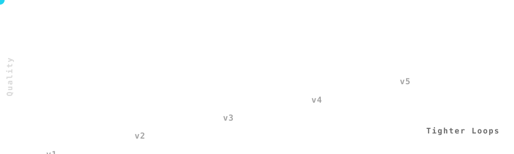

---

class: diagram

#### .icon[refresh-cw] Continuously Improves .font-grey[4/5]

## Flywheel


---

class: diagram

#### .icon[refresh-cw] Continuously Improves .font-grey[5/5]

## Raising The Bar


---

class: diagram

#### .icon[chart-line] Measures Outcomes .font-grey[1/5]

## Live Dashboard


---

class: diagram

#### .icon[chart-line] Measures Outcomes .font-grey[2/5]

## Activity vs Outcomes


---

class: diagram

#### .icon[chart-line] Measures Outcomes .font-grey[3/5]

## Cycle Time Gauge


---

class: diagram

#### .icon[chart-line] Measures Outcomes .font-grey[4/5]

## Instrumented Items

---

class: diagram

#### .icon[chart-line] Measures Outcomes .font-grey[5/5]

## Activity Funnel


---

class: diagram

#### .icon[expand] Highly Scalable .font-grey[1/4]

## Agents On Demand


---

class: diagram

#### .icon[expand] Highly Scalable .font-grey[2/4]

## Capacity Tracks Demand


---

class: diagram

#### .icon[expand] Highly Scalable .font-grey[3/4]

## Clone The Line


---

class: diagram

#### .icon[expand] Highly Scalable .font-grey[4/4]

## Hire vs Scale


---

class: diagram

#### .icon[sliders-horizontal] Business Controlled .font-grey[1/4]

## Control Panel


---

class: diagram

#### .icon[sliders-horizontal] Business Controlled .font-grey[2/4]

## Business Re-Ranks The Backlog


---

class: diagram

#### .icon[sliders-horizontal] Business Controlled .font-grey[3/4]

## Policy Gate


---

class: diagram

#### .icon[sliders-horizontal] Business Controlled .font-grey[4/4]

## Budget Guardrail


---

class: diagram

#### .icon[piggy-bank] Cost Effective .font-grey[1/4]

## Steps Vs Slope


---

class: diagram

#### .icon[piggy-bank] Cost Effective .font-grey[2/4]

## Coins Per Change


---

class: diagram

#### .icon[piggy-bank] Cost Effective .font-grey[3/4]

## Pay Per Use


---

class: diagram

#### .icon[piggy-bank] Cost Effective .font-grey[4/4]

## Same Budget More Output

